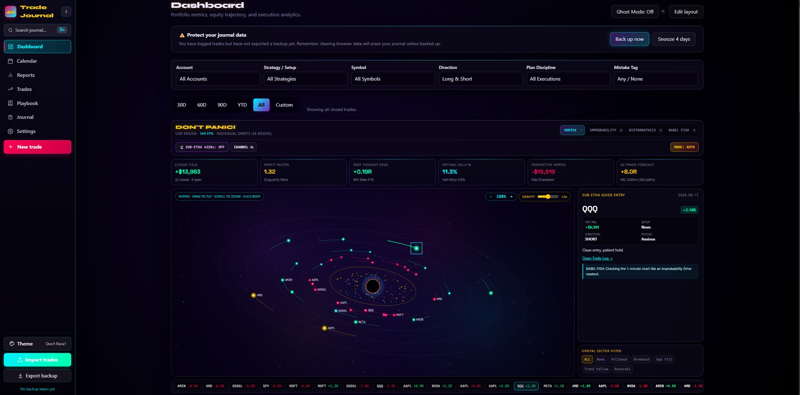
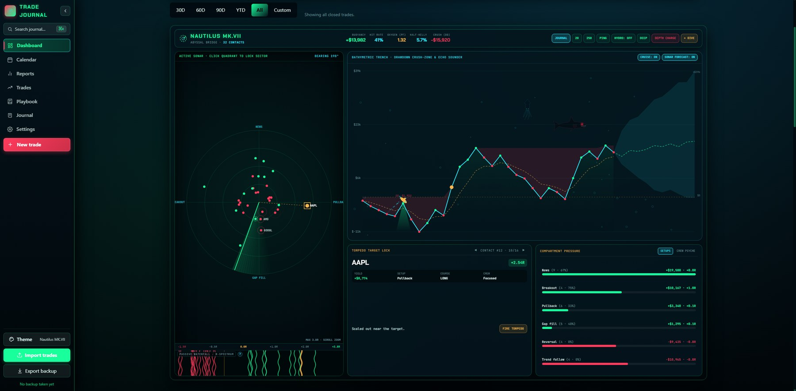
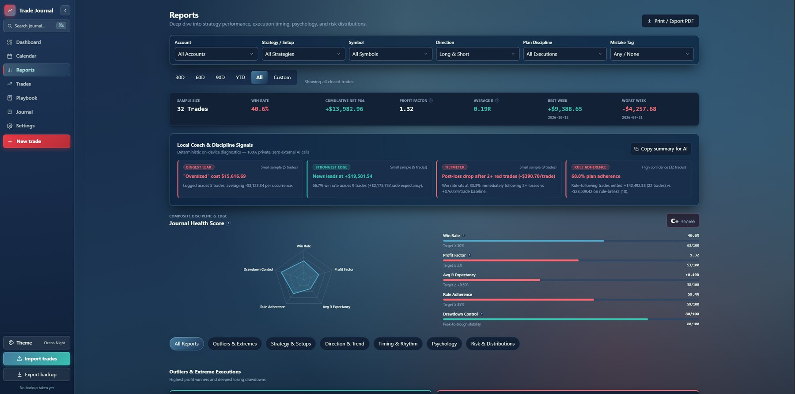
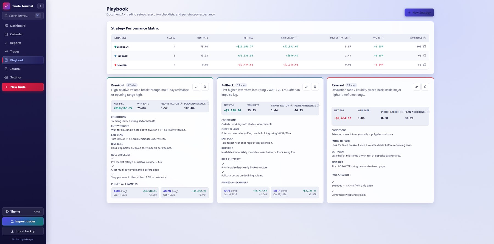

# 🚧 SleepWell Trading Journal 🚧

**Trade with clarity. Manage risk systematically. Sleep like a baby.**

A private, 100% client-side trading journal and execution analytics suite.

 

https://YOUR-SITE.workers.dev

> [!WARNING]
> ### 🚧 WORK IN PROGRESS 🚧
> SleepWell is under active development. Features, analytics, and UI change rapidly. Explore, test, and send feedback while it takes shape.
>
> This repository is a showcase only. The source code is private.

---

##  Screenshots

###  Interactive Workspaces / Command Decks &nbsp; 

Immersive, fully interactive dashboards that turn your trade data into a living scene.

  
   
  <b>Don't Panic!</b> Every trade becomes an orbiting body. Drag to tilt, scroll to zoom, and click a body to open its trade log.

  
   
  <b>Nautilus MK.VII</b> A sonar radar of your setups, plus a bathymetric equity chart showing drawdown zones and a forecast.

###  Included Themes &nbsp; 

Some of the basic themes that come out of the box.

<table>
  <tr>
    <td width="50%" align="center">
      
       <b>Ocean Night</b> · Reports
    </td>
    <td width="50%" align="center">
      
       <b>Cloud</b> · Playbook
    </td>
  </tr>
</table>

---

##  Why SleepWell

 **Private by design.** Trades, notes, and P&L live in your browser's IndexedDB. Nothing is sent to any server, and the built-in Privacy Audit proves it.

 **Psychology meets metrics.** Pre- and post-market journaling, a Strategy Playbook, and Ghost Mode sit next to the numbers, so you can find and fix behavioural leaks.

 **Risk-adjusted analytics.** R-multiples, drawdown, expectancy, profit factor, and time-of-day edge, with no spreadsheet formulas.

---

##  Features

| | |
| :--- | :--- |
|  **Portfolio Dashboard** | Equity curve, win rate, profit factor, net P&L, drawdown, and expectancy over custom time windows |
|  **Ghost Mode** | Compares your real equity curve with a clean one that removes rule-breaking trades, showing what indiscipline cost you |
|  **Strategy Playbook** | Define setups with rule checklists and pin your best trades as benchmarks |
|  **Local Insights** | On-device engine that flags tilt, time-of-day leaks, and position-size skew |
|  **Journal Health Radar** | Five-axis score for logging, prep, review, plan adherence, and R:R adherence |
|  **Global Filters** | Slice everything by date, symbol, setup, tag, side, and account |
|  **Heatmap Calendar** | Daily P&L with session notes and trade details |
|  **Risk Engine** | FIFO matching, multi-fill pairing, planned vs. realized R:R, fees and slippage |
|  **Theme Engine** | Free themes out of the box, plus premium interactive command decks |
|  **Markdown Journal** | Pre- and post-market templates with mindset prompts and execution audits |
|  **Trade Cards** | Paste screenshots from the clipboard and export shareable trade cards |
|  **CSV / Excel Import** | Presets for IBKR, Schwab, Thinkorswim, TradingView, MetaTrader, Robinhood, TradeStation |
|  **Backups & Privacy Audit** | One-click JSON export and restore, plus proof of zero outbound traffic |

---

##  Workflow

1. **Playbook:** define setups and pre-trade rules
2. **Pre-market:** review conditions and complete the mindset checklist
3. **Log trades:** manual entry with planned stop and target, or bulk import
4. **Review:** tag setups and mistakes, check R-multiples, write the debrief
5. **Analyze:** use Ghost Mode, Local Insights, and the Health Radar to find your edge and your leaks

---

##  Built With

Charts with Recharts, storage in IndexedDB, imports via PapaParse and SheetJS.

---

##  Data & Backups

Everything runs in your browser, so **your data never leaves your device.**

- **Privacy Audit:** Settings → Privacy Audit confirms no external requests
- **Backups:** use Export backup regularly, because clearing site data erases IndexedDB
- **Moving devices:** export a backup, then use Import trades → Restore Backup on the new device

---

🚧 Still building. Questions or feedback? Open an issue. 🚧

