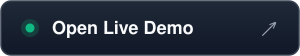
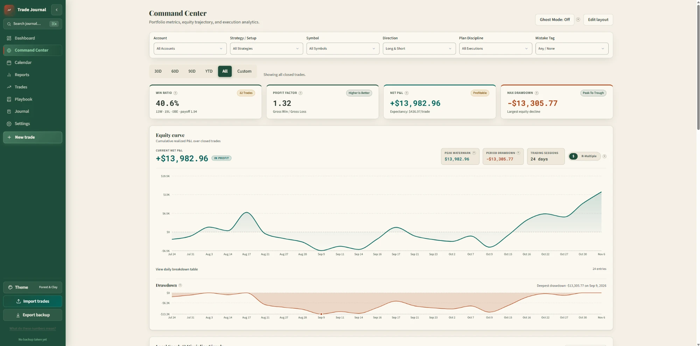
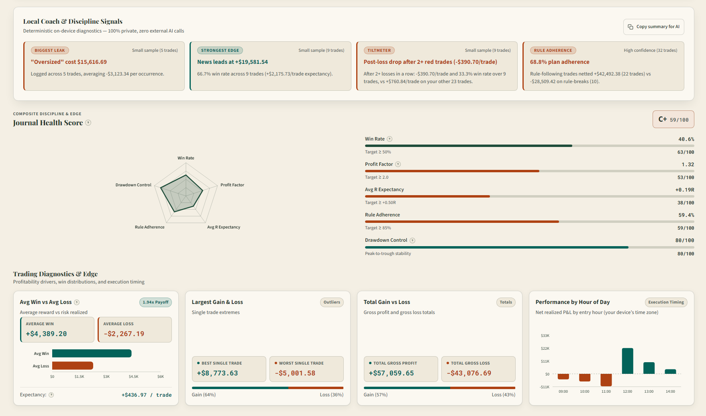
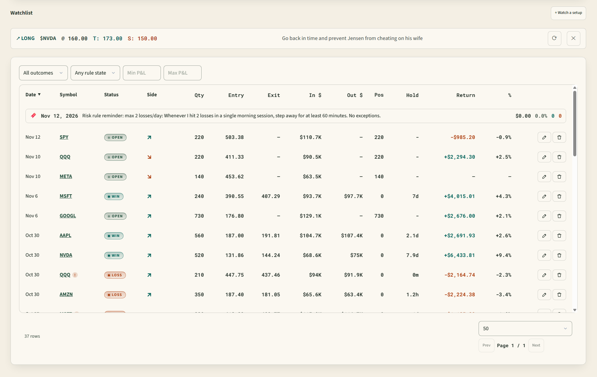
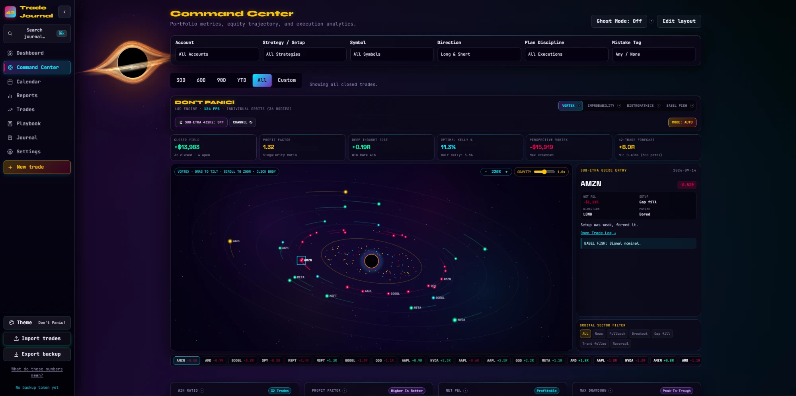
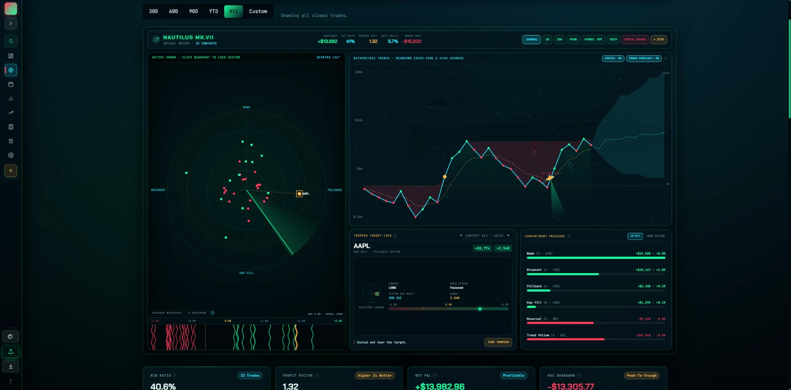
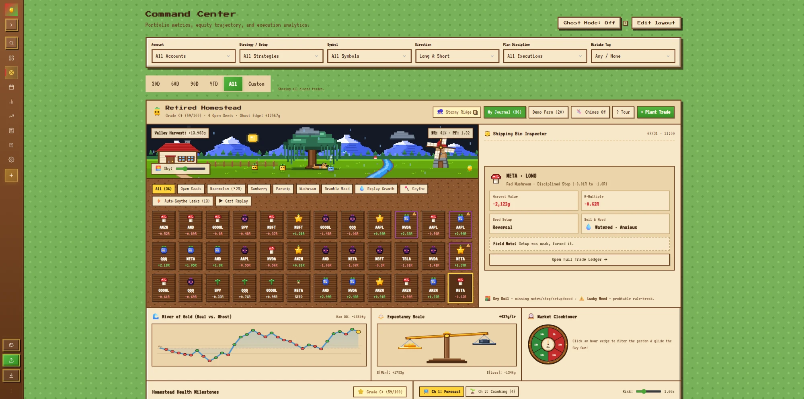

<div align="center">

# 🚧 SleepWell Trading Journal 🚧

**Trade with clarity. Manage risk systematically. Sleep like a baby.**

A private, 100% client-side trading journal and execution analytics suite.

<br>

<a href="https://sleepwell.journal-apps.workers.dev">
  
</a>

<sub>https://sleepwell.journal-apps.workers.dev/</sub>


</div>

> [!WARNING]
> ### 🚧 WORK IN PROGRESS 🚧
> SleepWell is under active development. Features, analytics, and UI change rapidly. Explore, test, and send feedback while it takes shape.
>
> This repository is a showcase only.

---

## 💡 Why SleepWell?

Most trading journals lock your trade data in cloud databases, sell subscription tiers, or overwhelm you with clunky spreadsheets. **SleepWell Trading Journal** is built on three core pillars:

1. **No Login, No Cloud, 100% Local (Zero Backend)**: No account, no signup, no subscription. Open the page and start journaling. All your trades, notes, P&L, and proprietary setups reside locally in your browser's native **IndexedDB**. Nothing is ever sent to external cloud servers or third parties. Verify it anytime with the built-in **Privacy Audit**.
2. **Psychological & Execution Alignment**: Profitable trading is 20% strategy and 80% emotional discipline. SleepWell pairs quantitative trade metrics with pre-market/post-market journaling, a **Strategy Playbook**, and **Ghost Mode** to systematically isolate and eliminate behavioural leaks.
3. **Institutional Risk-Adjusted Analytics**: Track R-multiples, peak-to-trough drawdowns, expectancy per trade, profit factor, time-of-day edge, and multi-dimensional breakdowns without tedious manual formula setup.

---

## ✨ Key Features & Capabilities

| Feature | Description |
| :--- | :--- |
| **📈 Dynamic Portfolio Dashboard** | Real-time equity curve, win ratio, profit factor, net P&L, period drawdown, and expectancy across customizable time windows (30D, 60D, 90D, YTD, All, Custom). |
| **👻 Ghost Mode (Discipline Leakage)** | Overlays your real equity curve against an alternate "Ghost" curve that removes trades where you broke rules or logged mistakes—quantifying your exact discipline leakage in dollars and R. |
| **📘 Strategy Playbook (`/playbook`)** | Define trading setups with custom color codes, pre-trade rule checklists, execution criteria, and pin your best A+ historical winning trades as visual benchmarks. |
| **🧠 Deterministic Local Insights** | Automated local engine that detects behavioral biases, time-of-day edge, revenge trading tilt triggers, position size skew, and setup anomalies—100% private with zero cloud calls. |
| **🕸️ Journal Health Radar** | Interactive 5-axis radar chart scoring your logging completeness, pre-market prep consistency, post-market review discipline, plan adherence rate, and R:R adherence. |
| **🔍 Universal Global Filter Bar** | Persistent application-wide filter bar allowing you to slice all analytics, calendars, and trade tables by Date Range, Symbol, Setup, Tag, Side (Long/Short), and Account. |
| **📅 Heatmap Trading Calendar** | Day-by-day P&L visualization with interactive day side panels displaying execution details, session notes, and trade logs for each session. |
| **⚖️ Risk & Execution Engine** | First-In-First-Out (FIFO) trade matching, multi-fill order pairing, planned vs. realized R:R metrics, multi-target planning, and fee/slippage impact accounting. |
| **📝 Markdown Session Journal** | Dedicated pre-market and post-market logs with guided mindset prompts, emotional checklists, setup hypotheses, and execution audits. |
| **🏷️ Deep Tagging & Attribution** | Categorize trades by Setup, Mistake Type, Asset Class, Strategy Tier, and Execution Grade to identify high-conviction setups. |
| **📸 Shareable Trade Cards & Paste** | Paste screenshots directly from the clipboard (`Cmd+V` / `Ctrl+V`), and generate high-resolution social/audit cards of your best trades with one click (via `html-to-image`). |
| **📥 Universal CSV / Excel Import** | Smart column-mapping wizard with built-in presets for **Interactive Brokers (IBKR)**, **Charles Schwab**, **Thinkorswim**, **TradingView**, **MetaTrader**, **Robinhood**, **TradeStation**, and generic files. |
| **🛡️ Privacy Audit & Backups** | Built-in Privacy Audit tool demonstrating zero outbound traffic, accompanied by one-click JSON backup export and restore. |

**Command Center: equity curve, drawdown and headline stats**



**Local Coach, Journal Health Score and trading diagnostics**



**Watchlist and unified trades table**



---

## 🚀 How to Use the Journal

### The Complete Disciplined Trading Workflow

```
   [ 1. Playbook & Rules ] ──► [ 2. Pre-Market Prep ] ──► [ 3. Live Execution ]
   Define A+ Setups            Check Market Bias           Log Planned Stops & R
   Set Pre-Trade Checklists    Complete Mindset Log        Paste Chart Screenshots
                                                                    │
   [ 5. Insights & Ghost Mode ] ◄── [ 4. Post-Market Debrief ] ◄───┘
   Quantify Discipline Leaks        Review Invalidation / Mistakes
   Audit Health Radar & Edge        Inspect Daily Calendar Heatmap
```

#### Step 1: Define Your Playbook (`/playbook`)
- Navigate to the **Playbook** tab.
- Click **New Strategy** to define your core setups (e.g. *Opening Range Breakout*, *Supply Zone Reversal*, *Trend Pullback*).
- Add strict **Pre-Trade Rules & Checklists** (e.g. *Volume > 1.5x average*, *HTF trend aligned*, *Risk ≤ 1.0R*).
- Pin up to 4 historical model winner trades as visual execution benchmarks.

#### Step 2: Pre-Market Routine (Mental Framing)
- Navigate to the **Journal** tab.
- Click **New Entry** and select the **Pre-Market Prep** template.
- Review market macro conditions, sector momentum, and key levels. Complete the mindset checklist to ensure you are emotionally neutral and ready to trade your rules.

#### Step 3: Log or Import Your Trades
- **Manual Entry**: Click **+ New Trade** from any page. Input the Symbol, Side (`BUY` / `SELL`), Quantity, Entry/Exit Prices, Execution Times, Planned Stop, and Planned Target. Paste trade chart screenshots directly from your clipboard!
- **Bulk CSV / Excel Import**: Click **Import trades** at the bottom of the sidebar. Choose a broker preset (**IBKR**, **Schwab**, **Thinkorswim**, **TradingView**, etc.) or map custom columns. Preview paired executions and import them in seconds.

#### Step 4: Trade Review & Execution Audit
- Open the **Trades** tab to review open and closed positions.
- In the **Trade Detail** view:
  - Check whether the trade adhered to your Playbook rules (`Followed Plan: Yes / No`).
  - Review your **R-Multiple** (e.g., `+2.4R` gain vs. `-1.0R` standard risk).
  - Assign a **Setup Tag** and any **Mistake Tags** (e.g., *Chased Entry*, *Moved Stop*, *FOMO*).
  - Generate a shareable image card to share or archive.

#### Step 5: Post-Market Debrief & Ghost Mode Analysis
- Head to the **Journal** tab to complete your **Post-Market Review**.
- Check the **Dashboard** and **Reports**:
  - Toggle **Ghost Mode** on the Equity Curve to see how much money emotional slips cost you versus sticking strictly to your plan.
  - Review the **Local Insights** panel for real-time edge and tilt warnings.
  - Inspect the **Journal Health Radar** to ensure your logging and reflection consistency remain top tier.

---

## 🎯 Practical Use Cases

### 1. The Ghost Mode Revelation: *Quantifying the Cost of Broken Rules*
* **The Challenge**: A trader is slightly profitable (+\$2,500 over 60 days) but feels exhausted, suspecting that lack of emotional discipline is eating away profits.
* **How SleepWell Solves It**:
  1. The trader marks trades that broke rules with `Followed Plan: No` and logs mistake tags (`Moved Stop`, `Chased`).
  2. Activating **Ghost Mode** generates the hypothetical clean equity curve, showing that without discipline breaches, net P&L would be **+\$8,200** (+12.4R higher).
  3. Seeing that emotional slip-ups directly cost **\$5,700** creates instant psychological clarity and motivates strict rule adherence.

### 2. The Systematic Momentum Trader: *Doubling Down on Playbook Setups*
* **The Challenge**: A trader executes 8 different patterns across breakouts, reversals, and mean-reversion, but portfolio performance is choppy and unfocused.
* **How SleepWell Solves It**:
  1. The trader creates strategy profiles in the **Playbook** with defined entry checklists and tags every trade accordingly.
  2. In the **Reports** section, the breakdown reveals that `Breakout` delivers an **82% win rate** with a **3.2 Profit Factor**, while `Mean Reversion` has a **24% win rate** and accounts for 75% of drawdowns.
  3. The trader deactivates the mean-reversion strategy in the Playbook and focuses 100% of capital on high-conviction breakout setups.

### 3. The Emotional Trader: *Eliminating the Afternoon Slump*
* **The Challenge**: A day trader consistently makes \$1,000 before 11:00 AM, but gives it all back during midday chop and finishes in the red.
* **How SleepWell Solves It**:
  1. The **Hourly Performance Bar** and **Local Insights** panel highlight a stark disparity: consistent positive expectancy between **09:30 AM – 10:30 AM**, followed by sharp negative expectancy from **12:00 PM – 02:00 PM**.
  2. The Local Insights engine flags: *"Time Leak: Trades taken between 12:00-14:00 show negative expectancy (-$420 net)"*.
  3. The trader sets a strict Playbook rule: *Screens off at 11:30 AM*.

### 4. The Prop Firm / Funded Account Trader: *Managing Drawdown Boundaries*
* **The Challenge**: Prop firm evaluations enforce strict maximum trailing drawdowns and daily loss caps.
* **How SleepWell Solves It**:
  1. The **Dashboard** prominently displays the **Peak Watermark** and live **Period Drawdown**.
  2. Every trade automatically tracks **R-Multiple** and risk parameters based on the Planned Stop.
  3. The trader uses the **Global Filter Bar** to isolate prop accounts and monitors drawdown distance to scale down size during pullbacks, protecting account survival.

---

## 🔒 Data Privacy & Backup Best Practice

> [!IMPORTANT]
> Because SleepWell operates **100% locally in your browser's IndexedDB**, your data is never stored on a remote server.
> 
> * **Run Privacy Audit**: Click **Settings > Privacy Audit** to verify that zero external network requests are made.
> * **Export Regular Backups**: Click **Export backup** in the sidebar periodically (e.g., weekly or monthly) to save a `.json` backup file.
> * **Switching Devices / Browsers**: To move your journal to a new computer or browser, export your backup from the old device and use **Import trades > Restore Backup** on the new one.
> * **Clearing Browser Data**: Take care when clearing browser cookies and site storage, as this may clear IndexedDB if you haven't saved a backup.

---

## 🎨 Themes

The journal is fully free, with six free themes: *Ocean Night*, *Obsidian*, *Evergreen*, *Ocean Breeze*, *Paper* and *Forest & Clay*. Optional **Pro themes** are cosmetic packs and change nothing about the features:

| Theme | Style |
| :--- | :--- |
| **Retired at 40 / Retired at 50** | A homestead where winners grow and mistakes show up as weeds, in a daytime and a midnight version. |
| **Don't Panic!** | Deep-space glass interface with a gravitational vortex around your trades. |
| **Nautilus MK.VII** | Submarine bridge with sonar, a passive R-spectrum waterfall and a bathymetric equity trench. |

Pro themes unlock with a one-time license key.

**Don't Panic!**



**Nautilus MK.VII**



**Retired at 40 (light)**



---

## 📄 License

Distributed under the MIT License. Feel free to fork, customize, and trade well!
